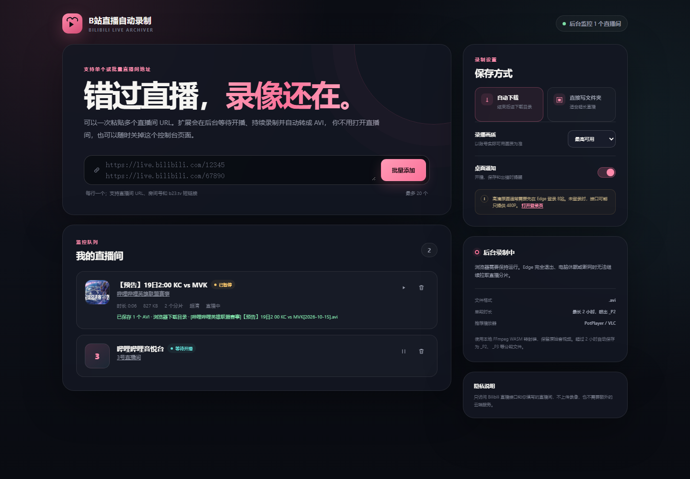

# B站直播自动录制（Edge 扩展）

输入 Bilibili 直播间 URL，扩展会在后台等待开播、持续拉取直播 HLS 分片并保存为 AVI。正常使用时不需要打开直播间页面，也不需要让控制台页面一直开着；只要 Edge 仍在运行，扩展就会继续监控。



## 安装

1. 在 Edge 地址栏打开 `edge://extensions/`。
2. 打开右下角的“开发人员模式”。
3. 点击“加载解压缩的扩展”，选择本目录。
4. 点击工具栏里的扩展图标，打开控制台。

如果工具栏没有图标，在“扩展”菜单里把“B站直播自动录制”固定到工具栏。

## 使用

1. 每行粘贴一个直播间地址，例如 `https://live.bilibili.com/12345`，也可以直接输入房间号或 `b23.tv` 短链接。一次最多添加 20 个直播间。
2. 点击“批量添加”。
3. 主播开播后会自动开始录制，下播后会结束本次录像。

默认在录像结束后自动下载。也可以在右侧选择“直接写文件夹”，指定保存目录，让长直播边录边转换成 AVI 并写入该目录。直接写文件夹模式在浏览器重启后可能要求重新授权该目录。录播画质可在“最高可用 / 1080P / 720P / 480P”之间选择。

## 文件格式

最终录像后缀固定为 `.avi`，使用本地 FFmpeg WASM 将直播 TS 流无转码转封装为 AVI，保留原始音视频：

- 文件主名为 `[主播名称]直播名称[直播日期].avi`，例如 `[某主播]今晚聊聊天[2026-10-18].avi`。
- 每个录像分段最长 2 小时。第 1 段使用标准文件名，超过 2 小时后自动生成 `_P2.avi`，再满 2 小时生成 `_P3.avi`，依此类推。
- 遇到同名文件时会自动追加 ` (2)`，不会覆盖旧文件。
- 临时 TS 文件只用于转换，转换成功后会自动清理。
- 推荐使用 PotPlayer、VLC 或 Windows 支持 AVI 的播放器打开。

如果本机安装了 FFmpeg，也可以把 AVI 继续无损转成 MP4：

```powershell
.\scripts\convert-to-mp4.ps1 -InputFile "D:\录像.avi"
```

## 画质和登录

扩展按 B站接口实际允许的画质拉流。未登录或主播限制时，可能只能拿到 480P/720P；登录 B站账号并重新开始录制通常可以获得账号可用的更高画质。部分付费、加密或 DRM 直播不会绕过平台限制。

## 已知限制

- Edge 完全退出、电脑休眠、断网时无法录制。
- 只从添加监控或检测到开播之后开始保存，无法补录开始前的直播画面。
- 浏览器不支持 WebAssembly 时无法生成 AVI。
- B站接口和 CDN 策略可能变化，导致偶发断流、分片丢失或需要更新扩展。
- `b23.tv` 短链接需要能正常跳转到直播间。
- 本工具仅供个人存档；请尊重主播和平台的权利，不要用于未经授权的传播或商业用途。

## 开发

```powershell
node --test
```

无构建步骤，所有源码均为原生 JavaScript。
